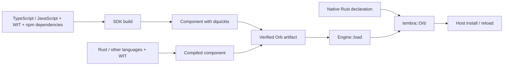

# Wasm Orb execution

`tembra-executor-wasm` prepares immutable Orb components for the existing Tembra host.
The kernel owns installation, principals, versions, state, resources, replacement and
physical settlement. Wasmtime executes each Orb revision in its own Store. Engines share
compiled code, never heaps or authority. This crate is not published separately.

All portable Orbs are WebAssembly components. The SDK builds JavaScript and TypeScript
with the pinned dquickts runtime and `wit-dylib`; Rust and other languages supply compiled
components. Both use their actual WIT imports and exports through the Canonical ABI.
Native Rust declarations remain available as trusted host code.



## Installation

```rust,ignore
use tembra::Host;
use tembra_executor_wasm::{Engine, Install, Limits};

let engine = Engine::new(Limits::default())?
    .filesystem("data", data_directory)?
    .network("outbound")?;

let arithmetic = engine.load(&std::fs::read(arithmetic_file)?, Install::default())?;
let calculator = engine.load(
    &std::fs::read(calculator_file)?,
    Install::default().requires("example:integrated/arithmetic@1.0.0", "arithmetic", 1),
)?;
let host = Host::new(pool.spawner());
host.install(vec![arithmetic, calculator])?;
```

Native packages include one pinned interpreter core. Source artifacts import it and carry their
own snapshots and WIT adapters; compiled modules are shared while Stores and heaps remain isolated.
`Engine::interpreted` selects Wasmtime's Pulley execution strategy, including on
platforms that prohibit executable memory; it does not select a different Orb format.

`Engine::load` verifies the component against its prepared contract before constructing an
Orb. Source components also export the private `tembra:orb` lifecycle: their declaration
must match the artifact before any factory runs. Callbacks and factories stay inside the
component. Install, reload and references use the ordinary Tembra APIs.

The complete Rust example is [examples/rust/wasm.rs](../../examples/rust/wasm.rs):

```sh
cargo run --locked -p tembra-executor-wasm --example wasm -- \
  <calculator.wasm> <arithmetic.wasm>
```

`Engine::instances()` reports live Stores and `Engine::resources()` reports exported WIT
resources retained for native owners. Both return to zero after physical shutdown.
`Engine::on_log` receives console records attributed by the host.

## Contracts and permissions

WIT defines callable interfaces and value types. An exported interface becomes the service
`<orb>::<package>/<interface>@<version>`. Imports identify contracts; `Install::requires`
chooses the installed provider and its API version. A native Rust Orb can provide an import
by registering the matching service and signature.

An import does not grant authority. `Install::grants` selects registered host providers and
per-Orb permissions:

- `FilesystemGrant { provider, mount, writable }` exposes a confined virtual mount.
  Read-only mounts refuse mutation. Browser providers include MemoryFS, OPFS and custom
  descriptor adapters; unsupported operations return standard errors.
- `NetworkGrant` separately authorizes TCP connect, listen, local bind, UDP peers and DNS.
  Browsers have no default raw-socket provider. An embedding can register an explicit
  `SocketProvider` with the capabilities its environment supplies.
- `HttpGrant { provider, origins }` authorizes exact normalized HTTP(S) origins.
  HTTP grants and raw socket grants are independent. The host handles DNS and TLS.
- `SystemCapability::{Clocks, Random, Cli}` authorizes the corresponding public WASI
  imports. `Install::cli(Cli)` supplies explicit arguments, environment, initial directory
  and byte stdio. Nothing inherits the host process environment or streams implicitly.

A type-only WIT reference supplies types, not callable authority. Callable resource
constructors and methods require the corresponding grants. Verification checks the actual
component imports, so metadata cannot hide callable WASI imports.

Public platform contracts use the bundled WASI 0.3 definitions. The source runtime also
imports specific WASI 0.2 interfaces internally. Those exact versioned names bind to a
separate private context: empty arguments, environment and preopens, no network, empty
stdin and discarded stdio. Internal random data is deterministic and is not security
material. Internal clocks are frozen unless the installation grants clocks. Public 0.3
providers and their permissions remain separate; there is no implicit version fallback.

## Execution and failures

`Limits` bounds each native Store's memory, fuel, packet size and callback wall time.
A trap or deadline quarantines that revision. Other Orbs retain their own Stores.

Each revision admits one callback at a time. A callback's result may arrive before its
physical work ends; the next callback waits for the originating task group to finish.
Imports and detached continuations retain that originating authority. Captured contexts
cannot acquire a later callback's principal. Imports during instantiation have no authority.

Source factories and synchronous WIT methods must return synchronously. Declare
`async func` for an asynchronous implementation. Module initialization has no host access,
including console output. Initialization and callback boundaries refuse reachable dormant
promises or queued work that could escape into a later invocation.

Errors declared as WIT `result` values are recoverable. An uncaught exception from an
export without a result lane traps. A raw stream producer failure traps instead of
appearing as clean EOF. Dropping a host future is not proof that its guest task has stopped;
cleanup retains physical ownership, and a revision that cannot resume safely is quarantined.
The runtime has no `FinalizationRegistry`; use explicit resource disposal.

## Value and capability transport

Public inter-Orb data ports exchange WIT-validated values. Supported data includes
integers through 64 bits, finite numbers, strings, characters, lists, records, tuples,
simple options, flags, enums, variants and results. JavaScript uses `bigint` for `u64` and
`s64`; Rust uses `u64` and `i64`. WIT-directed transport encodes those positions as decimal
strings in JSON packets and restores exact values. Ordinary WIT strings remain strings.

Arguments are captured before serialization. Accessors, `toJSON`, sparse arrays, cycles
and non-data objects are refused. Validation uses the prepared structural signature.
Negative zero, nested options, resources, streams and futures are outside the public data
profile; this is a transport profile, not a limitation of WIT.

The native Rust capability transport additionally supports whole owned resource results,
implicit borrowed method receivers and whole `stream<u8>` results of asynchronous
freestanding exports and imports. Source Orbs can import and export those byte streams
through the same native transport. See [owned WIT resources](../../docs/rust.md#owned-wit-resources)
and [portable byte streams](../../docs/rust.md#portable-byte-streams).

Compiled Orb imports acquire the provider's default `main` reference. Source methods can
select an object per request with `await context.get(binding, key)`. The root owns the
acquired claim; retained handles cannot use it from another root or after expiry.
Factory-declared references retain their declaration ownership. Dependency calls validate
the selected reference against the actual WIT import before dispatch.

Standard WASI resource handles stay inside their owning Store. Their streams and futures
are independent of the inter-Orb data profile and do not require a custom domain protocol.

## WASI adapters

Native execution links `wasmtime-wasi` and `wasmtime-wasi-http` 51.0.0-rc.1 for WASI 0.3.
The browser uses JCO calling conventions over Tembra's existing provider interfaces.
Bundled WIT definitions, linked interfaces and tested operations are separate claims.
The pinned upstream P3 HTTP implementation is experimental; the unstable timezone
interface is not linked.

| Package           | Host responsibility                                                                          |
| ----------------- | -------------------------------------------------------------------------------------------- |
| `wasi:filesystem` | Confined descriptors, preopens, metadata, directory operations and byte streams              |
| `wasi:http`       | Client and incoming handler resources, HTTP(S), bodies, trailers and request options         |
| `wasi:sockets`    | Granted TCP, UDP and DNS, with independent resource and stream lifetimes                     |
| `wasi:clocks`     | Explicit wall and monotonic clock providers and waits                                        |
| `wasi:random`     | Secure and insecure randomness; deterministic internal runtime data is separate              |
| `wasi:cli`        | Explicit arguments, environment and byte stdio; contained exit; terminal getters return none |

`@syntropika/tembra-sdk/http` lets an author write `await fetch(url)` over standard
`wasi:http/client` and `wasi:http/types`. HTTP framing, DNS and TLS run in the host.
Bodies stream byte chunks with backpressure. `response.events()` parses SSE;
`text()` and `json()` collect at most 1 MiB. Untouched responses can be retained for a
later callback; consume or close them explicitly. Active uploads belong to their
originating callback. This convenience API does not implement all WHATWG Fetch semantics.

The native sender supports HTTP/1 with `webpki_roots` trust anchors. It does not follow
redirects, use proxy settings or inherit custom/system CA stores. `fetchHttpProvider()`
adapts browser Fetch while preserving its platform restrictions: CORS, buffered uploads
up to 8 MiB, combined response fields and unavailable trailers or separate connect timeout.
An application-owned `HttpProvider.send` can supply a different transport.

Incoming HTTP uses `wasi:http/handler@0.3.0`. The application owns its listener,
authentication and routing. `tembra_executor_wasm::ingress::serve` admits each request
under its own root and retains physical ownership while the response streams. A handler
alone needs no outgoing HTTP grant. Its callback deadline includes the streamed body.
SSE and other long responses need an appropriate deadline.

Socket resources and their receive, send and listen streams have independent lifetimes.
Dispose each retained resource explicitly. `readChunks` and `writeChunks` use bounded
byte chunks. Browser adapters return standard unsupported errors for missing provider
capabilities rather than emulating raw sockets.

## Browser and mobile hosts

The browser verifies actual component bytes, then uses Tembra's packaged trusted compiler
to generate and instantiate JCO glue. It never evaluates guest-supplied JavaScript sidecars.
The compiler is loaded lazily. The current backend requires JSPI and a Content Security
Policy allowing `script-src blob:` and `'wasm-unsafe-eval'`; Chrome 154 is the qualified
browser. There is no fallback to the removed core-interpreter protocol.

Node and mobile use the same native component port. Mobile selects Pulley and needs no
separate interpreter asset. Local Pulley tests verify portable behavior, not iOS or Android
device support. Swift/Kotlin package and device qualification remain separate checks.

## Build the authoring runtime

The reusable runtime is an authoring input. It is built once with Rust 1.99.0,
`wasm32-wasip2` and WASI SDK 34, using pinned componentize-qjs and dquickts revisions plus
the reviewed [runtime patch](guest/patches/README.md). Changing an Orb does not rebuild Rust.

```sh
rustup toolchain install 1.99.0 --profile minimal --target wasm32-wasip2
just build-runtime <wasi-sdk> <cache-directory>
```

The build verifies pinned source trees and packages `runtime.wasm` in the Node engine's
authoring package. The SDK bundles the installed npm dependency closure, typechecks against
WIT, snapshots the closed module and produces one verified component artifact.
See [the TypeScript example](../../examples/wasm-orb/README.md).

## Qualification

The CI acceptance job prepares source fixtures and compiled components, then runs native
Rust, Bun, Node, Chrome, the example and packed-package consumers. Artifact-dependent
Rust tests use explicit fixture environment variables; ordinary workspace tests do not
establish those integration results.

```sh
just build-provider <target-directory>
just build-probe <target-directory>
just build-consumer <target-directory>
just build-resources <target-directory>
just build-streams <target-directory>
just build-contributor <target-directory>
just build-http-client <target-directory>
just build-sockets <target-directory>
just build-http-handler <http-handler-target-directory>
just test-wasm-acceptance --out <directory> \
  --provider <target-directory>/wasm32-wasip3/release/tembra_wasm_arithmetic.wasm \
  --probe <target-directory>/wasm32-unknown-unknown/release/tembra_wasm_probe.wasm \
  --consumer <target-directory>/wasm32-unknown-unknown/release/tembra_wasm_pipeline.wasm \
  --contributor <target-directory>/wasm32-unknown-unknown/release/tembra_wasm_contributor.wasm \
  --http-client <target-directory>/wasm32-unknown-unknown/release/tembra_wasm_http_client.wasm \
  --sockets <target-directory>/wasm32-unknown-unknown/release/tembra_wasm_sockets.wasm \
  --http-handler <http-handler-target-directory>/handler/wasm32-unknown-unknown/release/tembra_wasm_http_handler.wasm \
  --http-proxy <http-handler-target-directory>/proxy/wasm32-unknown-unknown/release/tembra_wasm_http_handler.wasm \
  --resource-provider <target-directory>/wasm32-unknown-unknown/release/tembra_wasm_resource_provider.wasm \
  --resource-consumer <target-directory>/wasm32-unknown-unknown/release/tembra_wasm_resource_consumer.wasm \
  --stream-producer <target-directory>/wasm32-unknown-unknown/release/tembra_wasm_stream_producer.wasm \
  --stream-consumer <target-directory>/wasm32-unknown-unknown/release/tembra_wasm_stream_consumer.wasm
```

Pass `--fixtures <directory>` to reuse prepared artifacts and repeat
`--suite native|sdk|node|browser|example|package` to select suites. The output directory
must not contain the checkout. Run `just test-mobile-wasm <fixtures> <provider> <probe>
<http-handler>` for the portable mobile transport tests.

Durable checkpoint/restore, guest tasks/listeners/subscriptions, compiled hook providers,
custom portable composition, exclusive or opaque resources and causal reentry into the same
Store are not provided by this integration.
