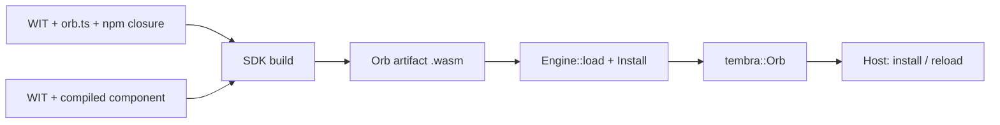

# Wasm Orb execution

Applications enable `tembra`'s `wasm` feature and use `tembra::wasm` to turn a built
Orb artifact into an ordinary `tembra::Orb`. This backend crate implements that facade.
The existing Tembra host and kernel own admission, principals, versions, state,
resources, replacement and physical settlement. This crate only executes
callbacks, in Wasmtime. Native-only applications do not depend on this backend.

An artifact is one immutable `.wasm` file with a prepared WIT contract and an Orb identity.
It contains either:

- **source**: a closed TypeScript/JavaScript bundle, run by a reusable dquickts
  interpreter core module; or
- **component**: a compiled WebAssembly component, run directly.

Each loaded Orb owns a separate Store. Engines share compiled code, not heaps or
authority. Native Rust Orbs installed in the same host run as trusted code outside
the Wasm sandbox.



## Load artifacts

```rust,ignore
use tembra::Host;
use tembra::wasm::{Engine, Install, Limits};

let engine = Engine::new(Limits::default())?
    // Needed only for source Orbs. Compiled components run without it.
    .interpreter(&std::fs::read(interpreter_file)?)?
    // Register providers; no Orb can use them until its installation grants them.
    .filesystem("data", data_directory)?
    .network("outbound")?;

let arithmetic = engine.load(&std::fs::read(arithmetic_file)?, Install::default())?;
let calculator = engine.load(
    &std::fs::read(calculator_file)?,
    Install::default().requires("example:integrated/arithmetic@1.0.0", "arithmetic", 1),
)?;

let host = Host::new(pool.spawner());
host.install(vec![arithmetic, calculator])?;
```

`Engine::load` returns the same `Orb` type as a native declaration. Install it
with other Orbs, replace it with `Host::reload`, and call it through ordinary
references. `Engine::instances()` reports live Stores; it returns to zero after
the host closes. `Engine::on_log` receives guest console output attributed by the
host, not by the guest.

A complete example is [examples/rust/wasm.rs](../../examples/rust/wasm.rs):

```sh
cargo run --locked -p tembra --features wasm --example wasm -- \
  <interpreter.wasm> <calculator.wasm> <arithmetic.wasm>
```

## Contracts and installation

Authoring resolves WIT once and lowers the selected world to a compact typed contract
inside the artifact. Source runtimes validate that model without loading a WIT parser.
Installation binds method signatures to slots; callback validation uses those slots
instead of repeating interface and method queries. Native compiled components are
also checked against the actual component imports and exports.

Ordinary WIT exports become services named `<orb>::<package>/<interface>@<version>`.
WIT imports name required contracts only. `Install::requires` selects which
installed Orb provides an import and its API version. A native Rust Orb can
provide an import when it registers the matching service name and signature.

`Install::grants` holds per-Orb authority. A WIT import never grants access:

- **Filesystem.** `FilesystemGrant { provider, mount, writable }` mounts a
  registered directory at a normalized virtual path. The operations available
  inside the mount depend on the artifact kind:
  - Source Orbs import generated standard descriptor bindings for binary reads, streamed
    writes/appends, metadata, directory enumeration and mutation. Descriptors survive callbacks
    until dropped or their revision retires. TypeScript authors can use typed `using` for
    deterministic disposal and bounded byte/text helpers above the standard streams.
  - Compiled components receive standard WASI preopens from upstream. Read-only grants permit
    reads; writable grants permit the corresponding file and directory mutations.
  - Browser source Orbs use memory, OPFS or injected descriptor providers. Unsupported
    platform operations return standard errors: built-in browser providers do not emulate
    hard links, symbolic links or setting timestamps; OPFS directory rename is unsupported.

  Neither kind can reach paths outside the mount.

- **Network.** `NetworkGrant` separately grants exact TCP `connect` peers, local
  `listen` addresses, explicit local `bind` addresses, UDP `datagrams` peers and
  `resolve` for DNS lookup. Standard compiled components use the upstream WASI
  socket implementation. Source bindings expose TCP, UDP, accept streams and DNS lookup;
  each operation still needs its corresponding grant and host provider.
- **HTTP.** `HttpGrant { provider, origins }` grants exact normalized HTTP(S)
  origins. DNS and TLS are handled by the host HTTP sender. Raw socket grants
  never authorize HTTP, and HTTP grants never authorize raw sockets.
- **Process-local interfaces.** `SystemCapability::{Clocks, Random, Cli}`
  explicitly admit their respective standard imports. Source and compiled Orbs use
  standard system/monotonic clocks, secure/insecure random and CLI byte streams.
  `Install::cli(Cli)` selects arguments, environment, initial directory and byte/file
  standard input/output. Defaults are empty input and discarded output. Rust embedders
  can supply reusable reader/writer factories; no process streams or environment are inherited.
  Clock and random factories on `Engine` configure fresh providers per Store.
  File adapters accept regular files only; devices, terminals, sockets and FIFOs are refused.
  A regular-file operation runs inline in bounded chunks, but its individual operating-system
  call is not preemptible by the callback deadline.

  Source `Date.now()`, zero-argument `new Date()`, `Date()` and `performance.now()` require
  Clocks; `Math.random()` requires Random and uses an explicitly insecure heap-owned PRNG.
  Pure date parsing and arithmetic remain available. Secure randomness never uses that PRNG.
  `wasi:cli/exit` retires only its invoking revision and reports its status to the host.
  Terminal getters return none for the supplied nonterminal adapters. The unstable timezone
  interface is not implemented by the pinned upstream release.

A type-only dependency supplies types, not callable authority: filesystem timestamps do
not require a Clocks grant. Resource-bearing dependency interfaces remain callable and
grant-bound, including their constructors and statics. Source bindings follow the selected
world's explicit imports; compiled admission additionally checks the actual binary's callable
WASI imports, so an artifact cannot hide them by claiming type-only metadata.

Installation fails when an Orb imports WASI sockets or filesystem without a
matching grant, or when a grant names an unregistered provider. The standard
WASI 0.3 definitions are bundled by `tembra-contracts`; authors do not copy them.

Wasmtime and wasmtime-wasi 51.0.0-rc.1 provide WASIp3 support. That support is
still experimental upstream.

## Limits and failure

`Limits` bounds memory, fuel, packet size and callback wall time for each Store.
Exceeding fuel or wall time terminates the callback. A trapped instance is
quarantined and reports `unavailable`; this does not change kernel object health.
Factory admission waits at most half the callback timeout.

## Value profile

The data transport exchanges domain values as WIT-validated, bounded JSON. Supported
values: finite numbers, integers through 64 bits, strings, characters, lists,
records, tuples, simple options, flags, enums, variants and results. Negative
zero, nested options, resource handles, streams and futures are rejected by this
data profile; these are not restrictions of WIT or WebAssembly. Native capability
transport additionally carries the resource and byte-stream shapes described below.

WIT `u64` and `s64` use `bigint` in JavaScript and ordinary `u64` and `i64` in Rust,
including inside records, lists and tagged payloads. JavaScript numbers, numeric
strings and out-of-range values are refused in 64-bit positions. Executor packets
carry canonical decimal strings at those positions, selected by the WIT type;
native Rust values remain exact numbers. A WIT `string` that contains digits stays
a string. Authors need no serialization wrappers or custom Serde attributes.

Host JavaScript arguments are captured once before serialization. Accessors, `toJSON`,
non-data objects, sparse arrays and cycles are refused; numeric typed arrays become lists
and explicit `undefined` becomes an absent option. The prepared contract checks those exact
bytes. Interpreted dependencies can reuse the checked capture only when the actual admitted
handler has the identical structural signature; ordinary host handlers retain boundary checks.
Guest result text is checked before decoding. Unchanged state reads transfer only their
kernel revision, while still checking the handle and its owner's lifetime.

Compiled components are checked against their full exported signatures and called
through the Canonical ABI. The native Rust facade additionally supports owned resource
results, including handles nested in records, lists, tuples, simple options, variants and results,
linear owned arguments, implicit borrowed method receivers and whole `stream<u8>` results of async
freestanding exports and imports; see
[owned WIT resources](../../docs/rust.md#owned-wit-resources) and
[portable byte streams](../../docs/rust.md#portable-byte-streams). Source Orbs installed
through the native Rust facade can also return or import a whole `stream<u8>` from an async
freestanding function. Their imported readers use the same SDK `readChunks` helper as WASI
body streams, without requiring a WASI import or grant. Public JSON ports still
use the data profile and refuse these stream contracts at installation. A compiled
component can import selected Orbs:

- A plain import declares one reference for the default key `main`. A
  [checked reference view](../../docs/tooling.md#keyed-dependency-references) instead exposes
  typed acquisition by key and methods on the returned resource. It declares no default;
  its host-local handles name kernel objects under the admitted root's principal.
- Each import call travels through the same scoped host request as a source Orb's
  dependency call, under the caller's admitted invocation. Kernel execution frames
  refuse causal reentry into the suspended importer; import arguments and results
  are checked against the importer's WIT signature, and the value profile applies to
  imports as well as exports.
- `func` imports block only the guest while the host awaits the provider. `async func`
  imports use P3 async lowering. A synchronously lifted export must not block on an
  `async func` import: the Component Model traps that call.
- Authority belongs to the call's Wasmtime task group. A call settles only after its
  result and all of its task group's work have finished, so work after `task.return`
  still runs under the call that started it. An import without such authority, for
  example during instantiation, is refused.
- A refused or failed dependency method traps the importer and quarantines its Store.
  A reference view's acquisition has an explicit WIT error result: an unapproved key or
  failed readiness returns that error without quarantining the revision. Provider calls
  already in flight remain physically owned until they settle.

Source methods can select a key per request using `await context.get(binding, key)`, where
`binding` names a selected WIT Orb import and `key` is a string or string tuple. Acquisition
uses the admitted caller's principal and the installed requirement's API version and method
set. It waits for readiness and releases the claim on failure or cancellation. The root owns
the claim: a retained guest handle cannot use it in another root or after expiry. Cleanup
callbacks cannot acquire instances. Declared factory dependencies keep their existing scope
ownership. This keyed-reference API does not transfer WIT resource handles or streams.

## WASI coverage

The bundled WIT definitions contain all six packages of the pinned WASI 0.3
release. Contract resolution, runtime linking and author-facing source bindings
are different capabilities; bundled definitions alone do not establish execution
support. Native compiled components link `wasmtime-wasi` and `wasmtime-wasi-http`
51.0.0-rc.1. Upstream labels its P3 HTTP implementation experimental and incomplete.

| Package           | Native compiled components                                                        | Source TypeScript Orbs                                                                       | Prepared browser components                                                                                                                                                   |
| ----------------- | --------------------------------------------------------------------------------- | -------------------------------------------------------------------------------------------- | ----------------------------------------------------------------------------------------------------------------------------------------------------------------------------- |
| `wasi:filesystem` | Standard descriptors under granted preopens                                       | Generated binary descriptor and directory bindings; browser memory, OPFS or custom providers | Actual guest byte/offset, append/truncate, metadata/hash/identity, directory, rights and lifetime scenarios over memory and OPFS                                              |
| `wasi:http`       | Standard client and incoming handler with streaming bodies and trailers           | Generated resources and HTTP/SSE convenience over native or injected transports              | Actual guest fields/request/response/options, duplex upload, trailers, errors, cancellation and retained responses; Fetch restrictions remain explicit                        |
| `wasi:sockets`    | Standard TCP, UDP and DNS with separate grants                                    | Generated TCP, UDP, accept-stream and name-lookup bindings                                   | Actual guest TCP/UDP methods, options, addresses, DNS, grants, cancellation and retained streams over injected providers                                                      |
| `wasi:clocks`     | System and monotonic clocks under an explicit grant                               | Generated clocks, resolutions and waits over native or injected clocks                       | Actual guest exact clock values, resolutions, both waits and cancellation                                                                                                     |
| `wasi:random`     | Secure and non-cryptographic random interfaces under a grant                      | Generated bytes, u64 and seed over native or injected providers                              | Actual guest secure/insecure bytes and u64; stable seed within one instance and fresh seed for another                                                                        |
| `wasi:cli`        | Explicit arguments, environment, initial directory and byte stdio; contained exit | Generated bindings and per-revision configuration                                            | Actual guest isolated configuration, binary streams, shared-sink serialization, I/O errors, backpressure, cancellation and all exit entrypoints; terminal getters return none |

The browser acceptance runner executes these operations through generated component bindings,
not direct JavaScript calls to the import objects. Its compiled filesystem, sockets and system
fixtures are required CI inputs alongside the HTTP fixtures. Source scenarios separately exercise
the interpreter's generated binary bindings. Native qualification reuses the upstream filesystem,
HTTP and sockets suites; compiled fixtures also exercise the actual component path.

The operation assertions live in the SDK's `component-{filesystem,http,sockets,system}-browser.ts`
tests and the executor's `wasi_operations` integration tests. They include permission refusal
before provider effects and physical resource cleanup, not just method availability. This is
qualification of the provided pinned profile, not a claim of complete upstream WASI conformance.

Memory and OPFS providers return standard unsupported errors for timestamp changes, hard links
and symbolic links; OPFS directory rename is also unavailable. Native filesystem error codes
can differ for the same invalid operation. The shared compiled fixture reports those outcomes,
and each host asserts its expected codes instead of forcing browser behavior on native WASI.

System grants govern declared standard imports for source and compiled Orbs.
Source JavaScript's ambient `Date`/`Date.now`/`performance.now` require a clocks grant,
and `Math.random` requires a random grant. Pure date parsing and arithmetic remain available.
The host supplies the clock and initial non-cryptographic seed; secure random bytes use the
standard random interface and never fall back to `Math.random`. The experimental `wasi:clocks/timezone` interface is not linked by
the pinned upstream runtime.

Compiled clock waits follow the cancellation of the invocation that issued them. Cancellation
completes their unit WASI result and drops the upstream timer; the cancelled scope remains
revoked, and the instance can serve a later call.

Compiled Orbs exporting exactly `wasi:http/handler@0.3.0` serve incoming HTTP through the
native Rust facade `tembra::wasm::ingress::serve`. The application owns the
listener, authentication and routing; `serve` runs each request under its own root until
the call has physically ended and returns the head while the body still streams. A
handler-only Orb needs no grant; `wasi:http/client` still requires an HTTP grant. The
handler is host-local, never a portable Orb service. Each revision serves one request at
a time, and the engine's `timeout_ms` bounds the whole request including its streamed
body: a response streaming longer than that times out and quarantines the revision.
Source Orbs can export that same handler contract. The SDK's host-owned incoming HTTP
entrypoint is exercised with source handlers in Chrome and with source and compiled handlers
in Node. Its binary transport preserves ordered duplicate fields, body chunks and trailers;
the application's listener and routing stay outside the Orb. The Fetch response adapter
explicitly refuses trailers that its platform cannot expose.

The SDK mobile adapter has a typed incoming HTTP carrier, but the React Native bridge and
actual mobile runtime require separate qualification. Native/Pulley and adapter tests do not
establish iOS or Android device support. Browser compiled components require an explicitly
registered application-owned adapter generated at build time; see
[browser preparation](../../docs/tooling.md#prepare-a-compiled-orb-for-browsers). JCO is never loaded
by the browser runtime. Each prepared component has separate memory, grants and budgets and
requires JSPI; source Orbs reuse the interpreter without JSPI.

## Current scope

Guests can use state reads, updates and selections, selected dependency
references, resource dependencies, internal cooperative waits, console output,
the granted filesystem, standard sockets and HTTP, and WIT-checked hook contributions.
Source Orbs can also declare `series`, `waterfall` and `bail` hooks. See
[portable hook contracts](../../docs/extensions.md#portable-hook-contracts).

Not yet available:

- guest tasks, listeners, state subscriptions and migration;
- compiled hook providers and portable custom composition, middleware or observation;
- service access policies and exclusive or opaque resources;
- causal reentry into the same interpreter;
- durable checkpoint and restore;
- fresh guest-local resources passed to another Orb before being issued under a provider claim;
- foreign-defined resource results, nested streams, non-byte streams and arbitrary futures beyond the bounded
  inter-Orb resource and byte-stream profile.

Replacement refuses a provider whose initial activation is still pending, and an
active native one-shot task blocks replacement.

## Build the interpreter

Building the interpreter requires the pinned Rust nightly with the `wasm32-wasip1`
target and WASI SDK 34. It pins and verifies a dquickts source revision. The
justfile `nightly` variable names the toolchain used locally, in CI and for releases.

```sh
rustup toolchain install "$(just --evaluate nightly)" --profile minimal --target wasm32-wasip1 --target wasm32-wasip3 --target wasm32-unknown-unknown
just build-interpreter <wasi-sdk> <cache-directory> [<dquickts-checkout>]
```

Without a checkout, the build clones dquickts into the cache directory. The recipe
copies the same verified `interpreter.wasm` into `@syntropika/tembra-engine-node` and
`@syntropika/tembra-engine-wasm`. Orb changes do not require rebuilding it.

## Qualification

Runtime tests need built artifacts. Ordinary workspace tests and `just check` skip
them. The CI `acceptance` job builds the interpreter and the compiled Rust provider
once, then runs every suite against them:

```sh
just build-provider <target-directory>
just build-probe <target-directory>
just build-consumer <target-directory>
just build-resources <target-directory>
just build-streams <target-directory>
just build-contributor <target-directory>
just build-http-client <target-directory>
just build-sockets <target-directory>
just build-http-handler <http-handler-target-directory>
just test-wasm-acceptance --out <directory> \
  --provider <target-directory>/wasm32-wasip3/release/tembra_wasm_arithmetic.wasm \
  --probe <target-directory>/wasm32-unknown-unknown/release/tembra_wasm_probe.wasm \
  --consumer <target-directory>/wasm32-unknown-unknown/release/tembra_wasm_pipeline.wasm \
  --contributor <target-directory>/wasm32-unknown-unknown/release/tembra_wasm_contributor.wasm \
  --http-client <target-directory>/wasm32-unknown-unknown/release/tembra_wasm_http_client.wasm \
  --sockets <target-directory>/wasm32-unknown-unknown/release/tembra_wasm_sockets.wasm \
  --http-handler <http-handler-target-directory>/handler/wasm32-unknown-unknown/release/tembra_wasm_http_handler.wasm \
  --http-proxy <http-handler-target-directory>/proxy/wasm32-unknown-unknown/release/tembra_wasm_http_handler.wasm \
  --resource-provider <target-directory>/wasm32-unknown-unknown/release/tembra_wasm_resource_provider.wasm \
  --resource-consumer <target-directory>/wasm32-unknown-unknown/release/tembra_wasm_resource_consumer.wasm \
  --stream-producer <target-directory>/wasm32-unknown-unknown/release/tembra_wasm_stream_producer.wasm \
  --stream-consumer <target-directory>/wasm32-unknown-unknown/release/tembra_wasm_stream_consumer.wasm
```

The runner builds the fixture Orbs with `scripts/test-wasm-fixtures.ts`, or reuses a
directory passed with `--fixtures`. It runs all executor tests natively, including artifact-dependent cases, the
SDK Bun and Node suites, Chrome with the packaged default engine and with an override
engine directory, the [Wasm Orb example](../../examples/wasm-orb/README.md), and
packed consumers in Node, Bun and Chrome with a clean NodeNext typecheck.
Repeat `--suite native|sdk|node|browser|example|package` to select suites. The output
directory must not contain the checkout. `--suite native` selects the
Rust tests against supplied artifacts.

The interpreter is a `wasm32-wasip1` reactor core module behind a private
fixed-buffer ABI, `tembra-interpreter-v12`. Its import namespace also carries the
digest of the generated WASI method and type table, so mismatched host/interpreter
bindings are refused before execution. [`src/abi.rs`](src/abi.rs) is its only
definition: the guest includes it, the native host compiles it, and the browser host
uses TypeScript constants generated from it. Two exports reserve one input buffer and
run one logical operation (load, declare, start, resume, cancel or capture); two
imports answer synchronous host requests. Replies list at most 128 pending effects
with JavaScript-safe integer identities. The host waits outside the Wasm stack and
resumes the same heap with the completed effects. Completion identities never select
kernel roots, declarations or contexts. Layout, UTF-8 or ownership violations and
any trap quarantine that instance.

Linear memory is imported: each instance receives its own memory whose maximum is
the configured `memoryBytes`, in addition to the VM heap limit and, natively, Store
limits and fuel. The module may import only that memory, the two host functions and
an exact WASI preview 1 allowlist with capabilityless implementations: an empty
environment, granted clocks (constant zero time without a clocks grant), standard output and error forwarded to attributed
diagnostics, and no preopened directories or other descriptors. `proc_exit` traps.
Engines with any other import are refused before instantiation. Orb contracts and
the compiled-component host retain their WASI interfaces. Source filesystem and transport
operations are host effects, so the browser interpreter does not require JSPI. Native source providers
use directory capabilities and exact socket destination grants. Browser providers
use memory or an explicitly supplied OPFS directory handle. The source VM receives
no WASI filesystem preopens or socket grants; its standard-library imports cannot
reach those providers.

Source bindings check the admitted callback before each I/O effect and retain physical
ownership until it settles, including after cancellation or an abandoned Promise. Native
filesystem methods call the upstream inline implementation during bounded Store turns; DNS
and nonblocking socket work progress on the shared reactor without occupying Node's libuv
pool. Pending borrows and streams retain descriptors until physical work ends. A callback's
unfinished write pumps end as EOF: already accepted bytes remain owned until consumed.

Source descriptors share a process-wide open-file budget derived from the soft OS limit,
without changing that limit. Each source revision has a private share of one eighth of that
pool (at least one unit), so one Orb cannot consume the entire source pool. Streams retain
both units for their physical lifetime. This counts issued descriptors and file-holding
streams conservatively, including repeated preopen handles; it is not an exact OS descriptor
census. The budget does not cover compiled components, which currently rely on upstream resource handling
and OS limits; it is not a complete process-wide file-descriptor guarantee.

Socket authors import `TcpSocket` or `UdpSocket` from `wasi:sockets/types@0.3.0`
and name lookup from `wasi:sockets/ip-name-lookup@0.3.0`. The same generated binary
bindings carry socket resources, byte streams, accepted sockets and standard errors.
`readChunks` and `writeChunks` transfer bytes in bounded chunks up to 64 KiB.
Socket resources and their streams have independent lifetimes: dropping a socket
alone does not close its receive, send or listen stream. Drop each retained resource
when finished. An accepted socket belongs to its receiving Orb and cannot cross
portable inter-Orb calls.

Cancellation closes a compiled stream read by that call; untouched retained streams
remain usable. Source cancellation revokes the pending read and leaves cleanup to
the guest. Both paths abort a blocked send and await its physical close. A forced
cancellation reports `other("call cancelled")` through the completion future; it can
win until the send's final close is acknowledged, even after its bytes reached the
OS. A real EOF or an explicit non-cancelled DROP keeps upstream's result. Socket
Orbs use a shared, lazy native stream adapter; its internal tables bound each stream
element type to 4,096 live entries per instance.

A browser host registers a typed `SocketProvider` under `isolated.providers.network`.
TCP, UDP, DNS and individual options are optional capabilities. An unavailable
operation returns its standard unsupported error; Tembra does not emulate browser
raw sockets. Network and HTTP provider registries are independent. Grants are checked
against the provider bound to each exact WIT import before any provider work begins.

`@syntropika/tembra-sdk/http` imports standard `wasi:http/client` and `wasi:http/types`.
Authors declare the client import in WIT and write `await fetch(url)`; HTTP framing, DNS and
TLS execute in the host. The same generated binary resource, stream and future bindings carry
raw headers, request/response bodies, trailers and request options. There is no source HTTP JSON
protocol. The convenience accepts text, bytes or an `AsyncIterable<Uint8Array>` request body;
native uploads stream with bounded chunks and backpressure. A failed producer fails its trailers
future, so the host does not commit a truncated upload.

A maintained `eventsource-parser` handles SSE through `response.events()`. `text()` and `json()`
collect at most 1 MiB; `response.body` streams without that collection limit. `response.headers`
is a snapshot: `get(name)` reads text, `getAll(name)` and iteration preserve raw bytes and
duplicates exposed by the host. `await response.trailers()` reads trailing fields after body
consumption. An untouched response may be retained between callbacks; iteration owns the active
body read and closes it on EOF or early return. Call `response.close()` when it is no longer
needed. The facade accepts absolute HTTP(S) URLs and does not implement complete WHATWG Fetch
semantics; pass an already percent-encoded URL. `HttpError.code` preserves the standard HTTP,
header or request-options failure (or is `undefined` for a payload-free refusal). Uploads and
their trailers must finish in their originating callback. Standard HTTP resource handles
belong to their owning Store and cannot be sent through the inter-Orb data profile.

Compiled components import real `wasi:http/client@0.3.0` resources from
`wasmtime-wasi-http`. Their bodies, streams and trailers use the upstream
implementation, without the source facade's collection limits. Each send requires
an admitted originating call and a granted origin. An untouched response resource belongs to its Orb revision and may survive calls. An active
body read belongs to the consuming call: an unfinished body closes when that call returns or
is cancelled, and call completion waits for physical connection cleanup. Keep the response
resource until the call that will consume it. Source input futures that remain unwritten at
callback end are abandoned with a standard error. Guest code must handle a closed stream;
code that ignores it or blocks elsewhere remains subject to the execution deadline.

The pinned native sender supports HTTP/1 with `webpki_roots` trust anchors. It
does not follow redirects, use proxy settings, or load custom/system CA stores.
The browser host accepts a typed `HttpProvider.send` adapter with raw byte fields, pull-based
bodies and trailers. `fetchHttpProvider()` adapts Fetch to that contract, preserving CORS and
other platform rules. The Fetch adapter buffers uploads up to 8 MiB, combines duplicate
response fields, cannot provide trailers or a separate connect timeout, and normalizes the URL
path. A custom provider also receives the validated raw `pathWithQuery`.
Fetch redirects are refused. Raw TCP has a separate optional socket-provider
interface and no ambient browser implementation.

SSE stays within its admitted callback and the configured callback/read deadlines.
Long-running operations need an appropriate host `timeoutMs`; cancellation closes
the connection promptly. Exceeding the callback deadline quarantines the Orb,
as with any other callback. WASI HTTP bodies use the standard bindings; domain
byte-stream results use the separate native capability transport described above.

Compiled components run on the same session owner as source Orbs: one Store per Orb
revision on a dedicated Wasmtime worker, admitted one callback at a time, without
occupying the libuv pool. They answer the same private host requests, so native, Node
and mobile adapters use one port type for both kinds. Callbacks can cancel while
waiting for admission; admitted callbacks retain physical ownership until their WASI
work and dependency calls settle. A terminal failure quarantines that Orb and refuses
its queued calls only after the Store and blocking WASI operations have stopped.
