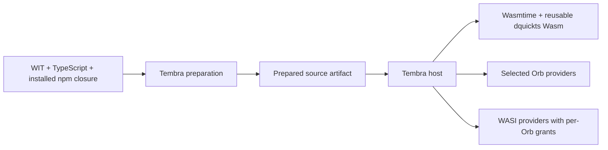

# Interpreted Wasm Orbs

This experimental adapter runs a closed TypeScript/JavaScript Orb in a reusable
dquickts WebAssembly component, hosted by Wasmtime. The existing Tembra kernel
owns admission, principals, versions, state identities, resources and physical
settlement. Each prepared Orb revision owns a separate Store and interpreter heap.
This crate is not published and does not replace the existing JavaScript executor.



Preparation resolves WIT, obtains TypeScript declarations from the official Jco
generator in memory, typechecks direct type-only `.wit` imports and bundles
installed dependencies. It does not acquire npm packages. The prepared artifact
contains the closed source, an encoded WIT package, the selected world and content
identities. Installation verifies the source digest and derives service metadata
and requirements from WIT plus explicit provider bindings. No generated author
files or original project directory are needed by the native consumer.

WIT imports identify required contracts. The installer selects providers and
grants authority separately. An import never grants filesystem or network access.
The standard WASI 0.3 filesystem, clocks and sockets definitions are bundled by
`tembra-contracts`; Orb authors do not need to copy those definitions. The runtime
uses Wasmtime 50.0.1 and wasmtime-wasi 50.0.0; their WASIp3 support remains an
experimental dependency of this adapter.

## Run the complete native example

Install the workspace's pinned dependencies and build its Node tooling adapter:

```sh
mise exec -- bun install --frozen-lockfile
mise exec -- just build-node
```

Set `WASI_SDK` to a WASI SDK 34 installation and `TEMBRA_ARTIFACTS` to an output
directory outside the source checkout. The guest requires a Rust nightly with
the `wasm32-wasip3` target. The build records the actual compiler and SDK identities.

```sh
python3 crates/executor-wasm/guest/build.py \
  --sdk "$WASI_SDK" --cache "$TEMBRA_ARTIFACTS/engine"
mise exec -- bun scripts/prepare-orb.ts \
  --entry examples/wasm-orb/orb.ts \
  --wit examples/wasm-orb/contract.wit --world calculator \
  --out "$TEMBRA_ARTIFACTS/calculator.json"
CARGO_TARGET_DIR="$TEMBRA_ARTIFACTS/rust-provider/target" cargo +nightly build \
  --locked --release --target wasm32-wasip3 \
  --manifest-path crates/executor-wasm/rust-provider/Cargo.toml
export TEMBRA_WASM_PROVIDER="$TEMBRA_ARTIFACTS/rust-provider/target/wasm32-wasip3/release/tembra_wasm_arithmetic.wasm"
cargo run --locked -p tembra-executor-wasm --example calculator -- \
  "$TEMBRA_ARTIFACTS/engine/engine.wasm" "$TEMBRA_ARTIFACTS/calculator.json" \
  "$TEMBRA_WASM_PROVIDER"
mise exec -- just test-wasm-orb \
  "$TEMBRA_ARTIFACTS/engine/engine.wasm" \
  "$TEMBRA_ARTIFACTS/calculator.json" "$TEMBRA_WASM_PROVIDER" "$TEMBRA_ARTIFACTS"
```

The consumer prints `24`: TypeScript sums `[3, 4, 5]` with the installed
`simple-statistics` package, calls a Rust arithmetic Orb compiled to a separate Wasm component and updates
managed state. Both implementations use the same canonical WIT file. Rust uses
the official `wit-bindgen` macro through a managed build output; its bindings are
not hand-written or checked into the author project. A separate test also covers
interoperation with trusted Rust host code.
The HTTP test additionally serves JSON on a local fixture, frames and parses HTTP
inside TypeScript in Wasm, and grants only its exact TCP destination. Rust guest
code implements the raw WASI transport. The host does not implement the HTTP client.

Change `orb.ts` and run preparation again to install different source. The reusable
engine binary does not need rebuilding. A new revision receives a new heap and
fresh grants. Existing roots retain their previous implementation and authority
until the kernel releases their version pins. The native `Host::reload` operation
uses the kernel's replacement program, retains compatible state, and restores the
installed version if candidate preparation or resource activation fails.

## TypeScript host facade

The Node host uses the same `createHost`, `install`, `get`, `prepare`, `reload`
and `close` lifecycle as other SDK consumers. The optional `createInterpreter`
backend hides Wasmtime and owns separate Stores for installed revisions. Its
`orb` method accepts either a prepared source artifact or a prepared compiled
component artifact; consumers do not select separate native/dynamic Orb models.

Prepare the compiled provider once, then run the Node consumer with closed
artifacts. The running consumer needs no WIT source or generated author files:

```sh
mise exec -- bun scripts/prepare-orb.ts \
  --component "$TEMBRA_WASM_PROVIDER" \
  --wit examples/wasm-orb/contract.wit --world arithmetic-provider \
  --out "$TEMBRA_ARTIFACTS/arithmetic.json"
mise exec -- just build-sdk
mise exec -- node examples/wasm-orb/consumer.mjs \
  "$TEMBRA_ARTIFACTS/engine/engine.wasm" \
  "$TEMBRA_ARTIFACTS/calculator.json" "$TEMBRA_ARTIFACTS/arithmetic.json"
```

`directoryFilesystem(path)` registers a Node/system directory provider. The
installer separately selects its WIT imports and grants a normalized virtual
mount, with explicit write access. Directory providers never grant ambient
access to another Orb.

The browser entrypoint also exposes `createInterpreter`, `memoryFilesystem`
and `opfsFilesystem`. Tembra prepares the reusable engine's browser modules with
`prepareBrowserEngine`; Jco configuration stays inside the tooling. Every Orb
receives isolated WASI namespaces over explicitly selected providers, including
read-only mounts. The optional Rust WIT parser loads separately from the small
metadata kernel. Browser source execution requires JSPI. Browser raw TCP and
compiled-component execution are not yet implemented.

Actual facade acceptance tests use prepared artifacts rather than mock engines:

```sh
TEMBRA_WASM_ENGINE="$TEMBRA_ARTIFACTS/engine/engine.wasm" \
TEMBRA_WASM_ORB="$TEMBRA_ARTIFACTS/calculator.json" \
TEMBRA_WASM_PROVIDER="$TEMBRA_WASM_PROVIDER" \
  mise exec -- node --test packages/ts/sdk/test/interpreter.node.test.mjs
TEMBRA_WASM_BROWSER_ENGINE="$TEMBRA_ARTIFACTS/browser-engine" \
TEMBRA_WASM_ORB="$TEMBRA_ARTIFACTS/calculator.json" \
  mise exec -- bun scripts/test-wasm-browser.ts
```

The browser test includes physical filesystem-write completion, memory/OPFS
storage, denied writes and traversal, replacement, cancellation, instruction
interruption, unresolved Promises and abandoned asynchronous work. The Node test
also runs a real compiled Rust provider, HTTP in TypeScript, system filesystem
access, isolated installations across host entrypoints and queued calls.

## Qualified profile and remaining scope

Real integration tests cover prepared artifact installation, npm calculation,
TypeScript-to-Rust calls, typed numeric lists, state updates, dependent resource
activation, errors and recovery, forbidden operations, concurrent admission,
creation during an outstanding call, cancellation cleanup, wall-time/fuel
termination, source replacement and rollback, filesystem reads/writes and denied
access, TCP destination grants, HTTP in TypeScript, and Store release on shutdown.
The runtime tests are explicitly ignored by ordinary workspace tests because they
require built engine and prepared source artifacts; use `test-wasm-orb` above.

The interpreter's domain methods use a WIT-validated, bounded JSON value profile.
The fixed interpreter transport uses the Component Model ABI, but domain methods
are not independent native Component Model exports. Supported values include
finite numbers, bounded integers through 32 bits, strings, characters, lists,
records, tuples, simple options, flags, enums, variants and tagged results. Negative
zero, nested options, 64-bit integers, resource handles, streams, futures and other
unsupported containers require additional codecs and are explicitly rejected.
Compiled components are additionally checked against full exported signatures,
including nested types, and execute through the real Canonical ABI. Their current
profile supports plain interface functions and standard WASI providers. Linking
Orb imports into compiled components still needs an additional adapter.

The guest currently exposes state reads/updates/selections, selected dependency
references, resource dependencies, cooperative waits, attributed console output,
bounded text filesystem operations and raw TCP transport. The HTTP helper is a
bounded UTF-8 HTTP/1 GET client for literal-IP `http:` URLs, not WHATWG Fetch; TLS,
DNS, redirects, encoded bodies and streaming need a further client profile.

The following integration work remains: browser compiled-component execution,
native in-memory filesystem providers, compiled-component Orb imports, durable
capture/restore, guest tasks/listeners/hooks, state subscriptions and migration,
service access policies, exclusive/opaque resource adapters and same-interpreter
causal reentry. Active one-shot native tasks prevent native replacement until a
restartable task adapter is available. Replacement also refuses a provider with
an object whose initial activation is still pending; await readiness before
retrying. Factory admission waits at most half the configured callback timeout,
so a causal request for a new object can fail without quarantining the healthy
interpreter. Trap quarantine reports unavailability;
it does not synthesize a kernel object-health transition. Ambient WASI clocks and
randomness have not been replaced with deterministic providers. Mobile remains
deferred. Passing native tests does not qualify these unfinished paths.

The private interpreter transport is `tembra:runtime/interpreter@0.3.0`.
Asynchronous host operations return scalar response tickets; a separate
synchronous import takes the payload once. Tickets are confined to one callback
and are discarded at its end. This avoids allocating response strings in an
asynchronous result path and avoids retaining abandoned owned reply resources
in the browser Component Model adapter. Ticket numbers never select kernel
roots, declarations or contexts.
