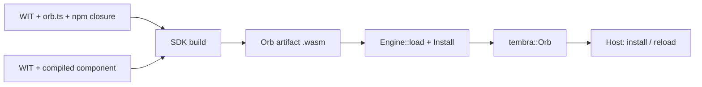

# Wasm Orb execution

`tembra-executor-wasm` turns a built Orb artifact into an ordinary `tembra::Orb`.
The existing Tembra host and kernel own admission, principals, versions, state,
resources, replacement and physical settlement. This crate only executes
callbacks, in Wasmtime. It is not published.

An artifact is one immutable `.wasm` file with a prepared WIT contract and an Orb identity.
It contains either:

- **source**: a closed TypeScript/JavaScript bundle, run by a reusable dquickts
  interpreter core module; or
- **component**: a compiled WebAssembly component, run directly.

Each loaded Orb owns a separate Store. Engines share compiled code, not heaps or
authority. Native Rust Orbs installed in the same host run as trusted code outside
the Wasm sandbox.



## Load artifacts

```rust,ignore
use tembra::Host;
use tembra_executor_wasm::{Engine, Install, Limits};

let engine = Engine::new(Limits::default())?
    // Needed only for source Orbs. Compiled components run without it.
    .interpreter(&std::fs::read(interpreter_file)?)?
    // Register providers; no Orb can use them until its installation grants them.
    .filesystem("data", data_directory)?
    .network("outbound")?;

let arithmetic = engine.load(&std::fs::read(arithmetic_file)?, Install::default())?;
let calculator = engine.load(
    &std::fs::read(calculator_file)?,
    Install::default().requires("example:integrated/arithmetic@1.0.0", "arithmetic", 1),
)?;

let host = Host::new(pool.spawner());
host.install(vec![arithmetic, calculator])?;
```

`Engine::load` returns the same `Orb` type as a native declaration. Install it
with other Orbs, replace it with `Host::reload`, and call it through ordinary
references. `Engine::instances()` reports live Stores; it returns to zero after
the host closes. `Engine::on_log` receives guest console output attributed by the
host, not by the guest.

A complete example is [examples/rust/wasm.rs](../../examples/rust/wasm.rs):

```sh
cargo run --locked -p tembra-executor-wasm --example wasm -- \
  <interpreter.wasm> <calculator.wasm> <arithmetic.wasm>
```

## Contracts and installation

Authoring resolves WIT once and lowers the selected world to a compact typed contract
inside the artifact. Source runtimes validate that model without loading a WIT parser.
Installation binds method signatures to slots; callback validation uses those slots
instead of repeating interface and method queries. Native compiled components are
also checked against the actual component imports and exports.

Ordinary WIT exports become services named `<orb>::<package>/<interface>@<version>`.
WIT imports name required contracts only. `Install::requires` selects which
installed Orb provides an import and its API version. A native Rust Orb can
provide an import when it registers the matching service name and signature.

`Install::grants` holds per-Orb authority. A WIT import never grants access:

- **Filesystem.** `FilesystemGrant { provider, mount, writable }` mounts a
  registered directory at a normalized virtual path. The operations available
  inside the mount depend on the artifact kind:
  - Source Orbs call host helpers that read and write bounded UTF-8 text files.
    They receive no WASI descriptors.
  - Compiled components receive the directory as a standard WASI preopen. A
    read-only grant allows reads only. A writable grant allows the WASI
    filesystem operations on files and directories inside the mount, including
    binary data, creating and removing entries, and listing directories. The
    text-only and size bounds of the source helpers do not apply.

  Neither kind can reach paths outside the mount.

- **Network.** `NetworkGrant { provider, connect }` permits outbound TCP to exact
  literal socket addresses. There is no DNS, listening socket or UDP.

Installation fails when an Orb imports WASI sockets or filesystem without a
matching grant, or when a grant names an unregistered provider. The standard
WASI 0.3 definitions are bundled by `tembra-contracts`; authors do not copy them.

Wasmtime and wasmtime-wasi 51.0.0-rc.1 provide WASIp3 support. That support is
still experimental upstream.

## Limits and failure

`Limits` bounds memory, fuel, packet size and callback wall time for each Store.
Exceeding fuel or wall time terminates the callback. A trapped instance is
quarantined and reports `unavailable`; this does not change kernel object health.
Factory admission waits at most half the callback timeout.

## Value profile

Source Orbs exchange domain values as WIT-validated, bounded JSON. Supported
values: finite numbers, integers up to 32 bits, strings, characters, lists,
records, tuples, simple options, flags, enums, variants and results. Negative
zero, nested options, 64-bit integers, resource handles, streams and futures are
rejected.

Host JavaScript arguments are captured once before serialization. Accessors, `toJSON`,
non-data objects, sparse arrays and cycles are refused; numeric typed arrays become lists
and explicit `undefined` becomes an absent option. The prepared contract checks those exact
bytes. Interpreted dependencies can reuse the checked capture only when the actual admitted
handler has the identical structural signature; ordinary host handlers retain boundary checks.
Guest result text is checked before decoding. Unchanged state reads transfer only their
kernel revision, while still checking the handle and its owner's lifetime.

Compiled components are checked against their full exported signatures and called
through the Canonical ABI. They support plain interface functions and the WASI
providers above. A compiled component can import selected Orbs:

- Its Orb root acquires one reference per Orb import binding, for the default key
  `main`. A plain WIT import names no object key, so other keyed objects are not
  addressable yet.
- Each import call travels through the same scoped host request as a source Orb's
  dependency call, under the caller's admitted invocation. Kernel execution frames
  refuse causal reentry into the suspended importer; import arguments and results
  are checked against the importer's WIT signature, and the value profile applies to
  imports as well as exports.
- `func` imports block only the guest while the host awaits the provider. `async func`
  imports use P3 async lowering. A synchronously lifted export must not block on an
  `async func` import: the Component Model traps that call.
- Authority belongs to the call's Wasmtime task group. A call settles only after its
  result and all of its task group's work have finished, so work after `task.return`
  still runs under the call that started it. An import without such authority, for
  example during instantiation, is refused.
- A refused or failed import traps the importer and quarantines its Store; Tembra does
  not fabricate WIT error values. This includes an import issued after the caller was
  cancelled. Provider calls already in flight remain physically owned until they settle.

## Current scope

Guests can use state reads, updates and selections, selected dependency
references, resource dependencies, internal cooperative waits, console output,
the granted filesystem, the granted TCP transport and WIT-checked hook contributions.
Source Orbs can also declare `series`, `waterfall` and `bail` hooks. See
[portable hook contracts](../../docs/extensions.md#portable-hook-contracts).

Not yet available:

- WASI HTTP, random and general clock capabilities, and socket listening, UDP or DNS;
- descriptor-level WASI filesystem access for source Orbs; only compiled components
  receive it, and only inside a filesystem grant;
- guest tasks, listeners, state subscriptions and migration;
- compiled hook providers and portable custom composition, middleware or observation;
- service access policies and exclusive or opaque resources;
- causal reentry into the same interpreter;
- durable checkpoint and restore;
- compiled-component execution in the browser.

Replacement refuses a provider whose initial activation is still pending, and an
active native one-shot task blocks replacement.

## Build the interpreter

Building the interpreter requires the pinned Rust nightly with the `wasm32-wasip1`
target and WASI SDK 34. It pins and verifies a dquickts source revision. The
justfile `nightly` variable names the toolchain used locally, in CI and for releases.

```sh
rustup toolchain install "$(just --evaluate nightly)" --profile minimal --target wasm32-wasip1 --target wasm32-wasip3 --target wasm32-unknown-unknown
just build-interpreter <wasi-sdk> <cache-directory> [<dquickts-checkout>]
```

Without a checkout, the build clones dquickts into the cache directory. The recipe
copies the same verified `interpreter.wasm` into `@syntropika/tembra-engine-node` and
`@syntropika/tembra-engine-wasm`. Orb changes do not require rebuilding it.

## Qualification

Runtime tests need built artifacts. Ordinary workspace tests and `just check` skip
them. The CI `acceptance` job builds the interpreter and the compiled Rust provider
once, then runs every suite against them:

```sh
just build-provider <target-directory>
just build-probe <target-directory>
just build-consumer <target-directory>
just build-contributor <target-directory>
just test-wasm-acceptance --out <directory> \
  --provider <target-directory>/wasm32-wasip3/release/tembra_wasm_arithmetic.wasm \
  --probe <target-directory>/wasm32-unknown-unknown/release/tembra_wasm_probe.wasm \
  --consumer <target-directory>/wasm32-unknown-unknown/release/tembra_wasm_pipeline.wasm \
  --contributor <target-directory>/wasm32-unknown-unknown/release/tembra_wasm_contributor.wasm
```

The runner builds the fixture Orbs with `scripts/test-wasm-fixtures.ts`, or reuses a
directory passed with `--fixtures`. It runs all executor tests natively, including artifact-dependent cases, the
SDK Bun and Node suites, Chrome with the packaged default engine and with an override
engine directory, the [Wasm Orb example](../../examples/wasm-orb/README.md), and
packed consumers in Node, Bun and Chrome with a clean NodeNext typecheck.
Repeat `--suite native|sdk|node|browser|example|package` to select suites. The output
directory must not contain the checkout. `just test-wasm-orb` runs the
Rust tests against supplied artifacts.

The interpreter is a `wasm32-wasip1` reactor core module behind a private
fixed-buffer ABI, `tembra-interpreter-v2`. [`src/abi.rs`](src/abi.rs) is its only
definition: the guest includes it, the native host compiles it, and the browser host
uses TypeScript constants generated from it. Two exports reserve one input buffer and
run one logical operation (load, declare, start, resume, cancel or capture); two
imports answer synchronous host requests. Replies list at most 128 pending effects
with JavaScript-safe integer identities. The host waits outside the Wasm stack and
resumes the same heap with the completed effects. Completion identities never select
kernel roots, declarations or contexts. Layout, UTF-8 or ownership violations and
any trap quarantine that instance.

Linear memory is imported: each instance receives its own memory whose maximum is
the configured `memoryBytes`, in addition to the VM heap limit and, natively, Store
limits and fuel. The module may import only that memory, the two host functions and
an exact WASI preview 1 allowlist with capabilityless implementations: an empty
environment, real clocks, standard output and error forwarded to attributed
diagnostics, and no preopened directories or other descriptors. `proc_exit` traps.
Engines with any other import are refused before instantiation. Orb contracts and
the compiled-component host retain their WASI interfaces. Source filesystem and transport
operations are host effects, so the browser interpreter does not require JSPI. Native source providers
use directory capabilities and exact socket destination grants. Browser providers
use memory or an explicitly supplied OPFS directory handle. The source VM receives
no WASI filesystem preopens or socket grants; its standard-library imports cannot
reach those providers.

Source helpers check the admitted callback before each I/O effect and retain physical
ownership until the operation settles, including after cancellation or an abandoned
Promise. TypeScript still constructs and parses HTTP inside the guest; only the
permitted raw transport runs in the host. One shared reactor handles nonblocking
sockets; at most four blocking workers handle filesystem operations with bounded
admission. Rust, Node and mobile share this path without occupying Node's libuv
pool. Permissions and request bounds are checked before queue admission;
expired queued operations cannot begin filesystem writes. Regular-file operations
retain ownership until physical completion; their completion is not interruptible.

`tembra.transport.connect(ip, port)` returns a byte stream with `read`, `write` and
`close`. Each chunk is at most 16 KiB. Streams belong to the callback that opened
them and close on completion, abandonment or cancellation; an old handle cannot
be used by the next callback. A slow read occupies no filesystem worker.

`@syntropika/tembra-sdk/http` implements HTTP/1 request and response framing in
TypeScript inside the guest. It supports request bodies, incremental byte bodies,
Content-Length, chunked responses and SSE through `response.events()`. Iteration
applies backpressure and closes the stream on an early return. `text()` and
`json()` collect at most 1 MiB; byte iteration does not collect the whole body.
The helper currently accepts literal-IP `http:` URLs. TLS, DNS, redirects and
content decompression are not implemented. These helpers do not expose the WASI
HTTP interface or a complete WHATWG Fetch implementation.

SSE stays within its admitted callback and the configured callback/read deadlines.
Long-running operations need an appropriate host `timeoutMs`; cancellation closes
the connection promptly. Exceeding the callback deadline quarantines the Orb,
as with any other callback. WIT stream values remain outside the current inter-Orb
value profile.

Compiled components run on the same session owner as source Orbs: one Store per Orb
revision on a dedicated Wasmtime worker, admitted one callback at a time, without
occupying the libuv pool. They answer the same private host requests, so native, Node
and mobile adapters use one port type for both kinds. Callbacks can cancel while
waiting for admission; admitted callbacks retain physical ownership until their WASI
work and dependency calls settle. A terminal failure quarantines that Orb and refuses
its queued calls only after the Store and blocking WASI operations have stopped.
