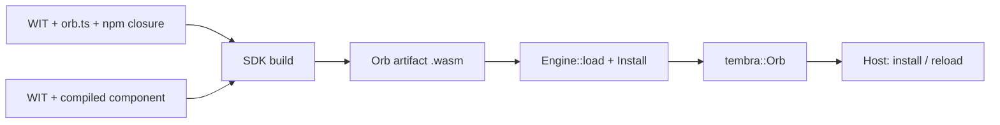

# Wasm Orb execution

`tembra-executor-wasm` turns a built Orb artifact into an ordinary `tembra::Orb`.
The existing Tembra host and kernel own admission, principals, versions, state,
resources, replacement and physical settlement. This crate only executes
callbacks, in Wasmtime. It is not published.

An artifact is one immutable `.wasm` file with a WIT contract and an Orb identity.
It contains either:

- **source**: a closed TypeScript/JavaScript bundle, run by a reusable dquickts
  interpreter component; or
- **component**: a compiled WebAssembly component, run directly.

Each loaded Orb owns a separate Store. Engines share compiled code, not heaps or
authority. Native Rust Orbs installed in the same host run as trusted code outside
the Wasm sandbox.



## Load artifacts

```rust,ignore
use tembra::Host;
use tembra_executor_wasm::{Engine, Install, Limits};

let engine = Engine::new(Limits::default())?
    // Needed only for source Orbs. Compiled components run without it.
    .interpreter(&std::fs::read(interpreter_file)?)?
    // Register providers; no Orb can use them until its installation grants them.
    .filesystem("data", data_directory)?
    .network("outbound")?;

let arithmetic = engine.load(&std::fs::read(arithmetic_file)?, Install::default())?;
let calculator = engine.load(
    &std::fs::read(calculator_file)?,
    Install::default().requires("example:integrated/arithmetic@1.0.0", "arithmetic", 1),
)?;

let host = Host::new(pool.spawner());
host.install(vec![arithmetic, calculator])?;
```

`Engine::load` returns the same `Orb` type as a native declaration. Install it
with other Orbs, replace it with `Host::reload`, and call it through ordinary
references. `Engine::instances()` reports live Stores; it returns to zero after
the host closes. `Engine::on_log` receives guest console output attributed by the
host, not by the guest.

A complete example is [examples/rust/wasm.rs](../../examples/rust/wasm.rs):

```sh
cargo run --locked -p tembra-executor-wasm --example wasm -- \
  <interpreter.wasm> <calculator.wasm> <arithmetic.wasm>
```

## Contracts and installation

WIT exports become services named `<orb>::<package>/<interface>@<version>`.
WIT imports name required contracts only. `Install::requires` selects which
installed Orb provides an import and its API version. A native Rust Orb can
provide an import when it registers the matching service name and signature.

`Install::grants` holds per-Orb authority. A WIT import never grants access:

- **Filesystem.** `FilesystemGrant { provider, mount, writable }` mounts a
  registered directory at a normalized virtual path. Guests can read and write
  bounded UTF-8 text.
- **Network.** `NetworkGrant { provider, connect }` permits outbound TCP to exact
  literal socket addresses. There is no DNS, listening socket or UDP.

Installation fails when an Orb imports WASI sockets or filesystem without a
matching grant, or when a grant names an unregistered provider. The standard
WASI 0.3 definitions are bundled by `tembra-contracts`; authors do not copy them.

Wasmtime 50.0.1 and wasmtime-wasi 50.0.0 provide WASIp3 support. That support is
still experimental upstream.

## Limits and failure

`Limits` bounds memory, fuel, packet size and callback wall time for each Store.
Exceeding fuel or wall time terminates the callback. A trapped instance is
quarantined and reports `unavailable`; this does not change kernel object health.
Factory admission waits at most half the callback timeout.

## Value profile

Source Orbs exchange domain values as WIT-validated, bounded JSON. Supported
values: finite numbers, integers up to 32 bits, strings, characters, lists,
records, tuples, simple options, flags, enums, variants and results. Negative
zero, nested options, 64-bit integers, resource handles, streams and futures are
rejected.

Compiled components are checked against their full exported signatures and called
through the Canonical ABI. They support plain interface functions and the WASI
providers above. Imports from a compiled component to another Orb are not yet
supported.

## Current scope

Guests can use state reads, updates and selections, selected dependency
references, resource dependencies, internal cooperative waits, console output,
the granted filesystem and the granted TCP transport.

Not yet available:

- full WASI filesystem, HTTP, sockets, clocks and random as guest capabilities;
- guest tasks, listeners, hooks, state subscriptions and migration;
- service access policies and exclusive or opaque resources;
- causal reentry into the same interpreter;
- durable checkpoint and restore;
- compiled-component execution in the browser;
- mobile hosts.

Replacement refuses a provider whose initial activation is still pending, and an
active native one-shot task blocks replacement.

## Build the interpreter

Building the interpreter requires a Rust nightly with the `wasm32-wasip2` target
and WASI SDK 34. It pins and verifies a dquickts source revision.

```sh
just build-interpreter <wasi-sdk> <cache-directory> <dquickts-checkout>
```

With `--package`, the recipe copies `interpreter.wasm` into
`@syntropika/tembra-engine-node` and the browser modules into
`@syntropika/tembra-engine-wasm`. Orb changes do not require rebuilding it.

## Qualification

Runtime tests need built artifacts and are ignored by ordinary workspace tests.
`scripts/test-wasm-fixtures.ts --out <directory> [--provider <component.wasm>]`
builds the fixture Orbs; `just test-wasm-orb` runs the ignored Rust tests against
supplied artifacts.

The private interpreter transport is `tembra:runtime/interpreter@0.4.0`.
The interpreter returns typed progress and pending effects. The host waits outside
the Wasm stack and resumes the same heap with the completed effects. Completion
identities never select kernel roots, declarations or contexts.

The serialized interpreter uses the WASIp2 toolchain to keep its stack inside Wasm.
This is an internal engine choice. Orb contracts and the compiled-component host
retain their WASI interfaces. Browser JSPI suspends actual WASI I/O; ordinary
inter-Orb waits do not create component asynchronous tasks.
