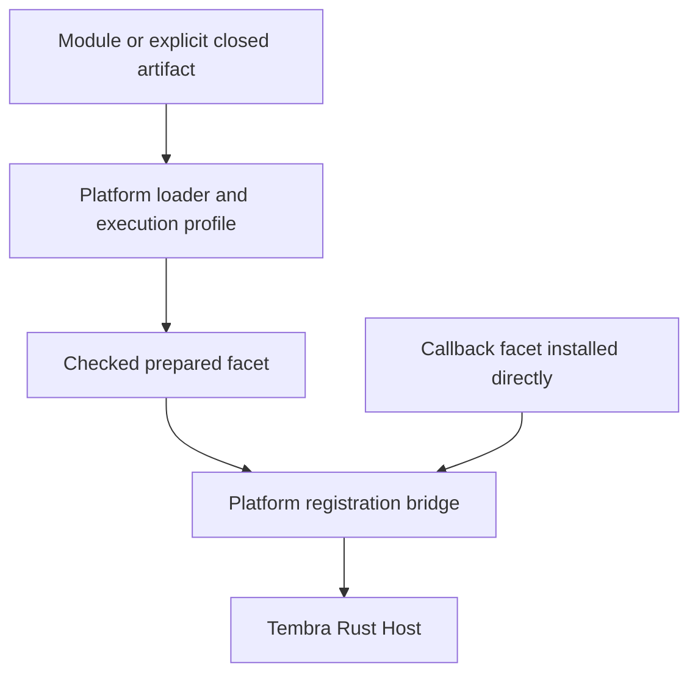

# Architecture

Tembra has one authoritative Rust object engine and platform-specific ways to execute facet code.
Applications use typed contracts and managed references. A loader prepares a facet; the core owns
what that facet contributes and how long its objects, state, resources and executions remain valid.
See the [guide](guide.md) for application usage and the [specification](spec.md) for behavioral rules.

## The module boundary

A platform loader owns module acquisition, evaluation and its declared execution profile. It selects
an export and checks that the result is a facet. For a closed artifact, it also enforces that format's
hash and closed-module rules. A normal platform module does not need an artifact envelope.

A prepared facet is the boundary between evaluated code and managed execution. Bindings retain the
JavaScript callbacks and values required by that facet and register its declarations in Rust.
Registration and subsequent reload use core-owned execution versions. The core does not parse
TypeScript, resolve npm packages, maintain a JavaScript module cache or choose Jiti versus native ESM.

`install()` starts at the registration boundary with callbacks already in the application's runtime.
`load()` reaches the same boundary through a loader. `reload()` prepares candidates and delegates
compatibility, commit, state preservation and version retirement to the existing core machinery.
There is no TypeScript object engine or independent reload algorithm.

## Platform execution

| Platform | JavaScript execution | Rust connection | Module delivery |
| --- | --- | --- | --- |
| Node | Existing Node runtime | Node-API addon | Jiti source profile; native ESM for explicit closed artifacts. |
| Browser | Existing browser or Worker runtime | `wasm-bindgen` | Native ESM URLs and validated closed artifacts. |
| Rust with JavaScript | Optional embedded V8 | Executor's Rust adapter | Validated closed artifacts for the embedded executor. |

### Node

`@tembra/sdk/node` creates `tembra-node-binding` through Node-API. Its callback adapter connects
native facet setup, factories, methods, state, resources, hooks and opaque values to the same Rust
Host. It has no dependency on `tembra-executor-js`, `deno_core` or a second embedded V8.

The Node source loader uses Jiti 2.7.0 with a fresh preparation graph, disabled filesystem/module
caches and a synchronous transformed execution profile. It supports local JavaScript/TypeScript
modules and installed dependency resolution within that profile. CommonJS wrapper semantics are
explicit; the profile does not claim native ESM equivalence. The Jiti compiler bootstrap runs in a
compiler-only VM context to avoid mutating the application's Error configuration. Facet callbacks
execute in the existing Node realm and can retain ordinary JavaScript identity.

A `tembra-esm-v1` input uses native ESM after its closed artifact validation. This separate evaluator
serves a distinct explicit execution contract; passing that artifact does not opt into transformed
source semantics. Neither evaluator is an untrusted-code sandbox.

### Browser

`@tembra/sdk/browser` creates a Rust Host compiled to WASM and wraps its issued handles through
`wasm-bindgen`. Facet callbacks run in the browser's JavaScript engine. Module loading delegates
native import, import maps, URL resolution and dependency caching to the browser. Relative paths
use the configured `baseURL` or the ambient document/Worker base.

Development tools such as Vite serve executable JavaScript from TypeScript source. The Host does
not transpile browser `.ts` URLs. CSP and CORS remain platform constraints. Native cache entries
are not invalidated by `host.reload()`; an embedding controls how changed URLs and dependencies are
published. Closed artifacts follow their explicit validation and native ESM evaluation path.

### Optional Rust embedding

`tembra-executor-js` remains available to Rust applications that need embedded JavaScript. Its V8
executor adapts foreign facet code to the same Rust Host semantics. Keeping it independent allows
Rust embeddings to choose their engine without imposing that engine on Node or browser consumers.

## Modules and responsibilities

| Module | Owns |
| --- | --- |
| `crates/core` (`tembra-core`) | Object identity, claims, contexts, state, resources, facet declarations, registries, execution versions, reload and lifecycle. |
| `crates/contracts` (`tembra-contracts`) | Portable contract descriptors, schema/identity rules and native adapter contracts. |
| `crates/hooks` (`tembra-hooks`) | Managed hook strategies and composition over core operations. |
| `crates/tembra` and `crates/macros` | Typed Rust application facade and generated contract/provider/reference API. |
| `crates/native` (`tembra-native`) | Native scheduling and transport adapters. |
| `crates/node-binding` | Node-API handles, callback ownership, generation admission and adapters to the Rust Host. |
| `crates/browser-wasm` | WASM binding, browser driver and checked JavaScript handles over the Rust Host. |
| `crates/executor-js` | Optional embedded JavaScript execution for Rust applications. |
| `crates/codegen` | Rust binding generation from verified portable descriptors. |
| `packages/sdk` | Shared TypeScript contracts and authoring API, platform facades/loaders, HostManagers and tooling entry points. |
| `testing` | Cross-language fixtures, integration suites and test support kept outside production libraries. |
| `examples` | Small applications using the final public API. |

`@tembra/sdk/tooling` provides programmatic typechecking, contract generation, bundling and
development delivery. These functions belong to build/development tooling; ordinary runtime imports use
`@tembra/sdk`, `@tembra/sdk/node` or `@tembra/sdk/browser`. There is no separate tooling package that
re-exports the runtime SDK.

## Ownership and state

The Host's address space uses contract name, normalized input and principal. An acquired reference
owns a claim; a binding wrapper carries that authority without creating another object model.
State cells, derivations and resources remain core-owned. JavaScript values may be retained by
issued resource handles, and generic binding adapters support portable hooks and registered opaque
JavaScript capabilities. Arbitrary Rust native types still need appropriate Rust adapters.

A call root pins its execution version. During compatible reload, new roots can use the replacement
while admitted old roots continue under their original version. The core handles state validation,
migration, resource handoff and retirement. Bindings retain the callbacks and values needed by
physical invocations until they settle, even if their public awaiter has already completed or left.

This boundary is the reason loader choice can change without replacing object identity, hooks or
reload semantics. A loader cannot independently free callbacks still owned by a Rust generation.

## Environment supervision

Code retirement in Tembra is not physical unloading of a JavaScript module. Native ESM caches and
other runtime references can retain code after Tembra releases its owners. Lower observed retention
with Jiti does not establish a universal collection guarantee. Cumulative finite admission therefore
applies to managed evaluation attempts and source costs; the [specification](spec.md#module-admission-and-memory)
records limits and diagnostics. These are admission bounds, not a cap on arbitrary trusted code's
heap allocations.

HostManagers separate environment supervision from object reload. Node uses `forkDriver` for child
processes; browser uses `webWorkerDriver` for Workers. Each environment has its own Rust Host.
Portable core RPC frames connect it to the supervising Host through a bounded transport pump;
opaque local values do not cross that connection.

`start()` creates the child environment, `stop()` joins its managed cleanup before termination,
and `replace()` creates a fresh environment after stopping the previous one. Parent shutdown stops
owned children before closing parent services, so child resource closers can still use those services.
A forced termination or cleanup timeout cannot promise completed external cleanup.

Replacing an environment releases its runtime as an environment boundary, but loses that child's
in-memory objects, references and state. It is not an implementation of `host.reload()`. Persistence,
reconnection and migration across environment replacement are embedding-application concerns;
no loader silently restarts a Host to replenish its budget.

## Build and verification boundaries

The SDK has two build scripts, each with one output responsibility:

- `scripts/build-sdk.ts` emits the TypeScript SDK and declarations, preserving staged native/WASM assets.
- `scripts/build-bindings.ts` runs Cargo for Node-API or browser WASM and stages the generated assets.

These paths are relative to `packages/sdk`. The binding script runs directly with Node's TypeScript
support. Its Cargo metadata determines the target output directory, and it rejects a Node dependency
graph containing an embedded JavaScript engine. SDK emission and binding compilation have distinct
outputs; runtime facet loading invokes neither script. Applications call build/development APIs
directly with Bun; the SDK does not publish a command-line executable.

Unit tests remain with each Rust/TypeScript library. Cross-language and non-unit coverage is under
`testing/rust`, `testing/typescript` and shared `testing/fixtures`. Actual Node and browser integrations
exercise the bindings, compatible reload, retained references, hooks, opaque identity and cleanup.
The browser runner launches real Chromium; a TypeScript compile alone does not establish browser
runtime compatibility. Examples remain applications rather than test fixture emitters or low-level
adapter demonstrations.
