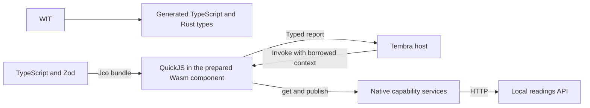

# Experimental TypeScript Orb with HTTP and live updates

This example runs TypeScript and an npm dependency inside QuickJS in a Wasm component. It uses the actual Tembra kernel and Wasmtime. It reads temperatures over HTTP, calculates statistics, publishes progress and replaces the script without rebuilding Wasm.

The example is isolated from the production executors. Its prepared component uses a private matched componentize-qjs and wit-dylib correction. It is suitable for reviewing this bounded prototype, not a production adoption claim. Mobile remains outside this example.

## Read the code

- [TypeScript Orb](fixtures/analysis-a.ts): validation, calculation and alert decision.
- [WIT contract](wit/example.wit): imported HTTP/progress functions and the exported analysis function.
- [Native host](src/main.rs): services, real HTTP requests and verification.
- [Component binding](src/engine.rs): WIT-derived Rust bindings and source loading.
- [Experimental adapter](src/adapter.rs): versioned contributions and physical settlement on Tembra.
- [Engine provenance](assets/engine.json): pinned upstream revisions, component hash and private patches.

The API returns these reproducible readings:

```json
{ "station": "greenhouse", "samples": [18, 20, 21, 25] }
```

The threshold is 22. The second script changes one line from `const calibration = 0` to `const calibration = 1.5`.

| Output  | First version | Edited version |
| ------- | ------------- | -------------- |
| Mean    | 21            | 22.5           |
| Median  | 20.5          | 22             |
| Minimum | 18            | 19.5           |
| Maximum | 25            | 26.5           |
| Alert   | false         | true           |

## Run

Use Rust 1.99.0, Node 24, Bun 1.4.3 and Python 3. The JavaScript dependencies and Cargo lockfile belong to this standalone example. It does not change the SDK workspace dependencies.

From the repository root:

```sh
bun install --cwd examples/wasm-typescript-http --frozen-lockfile
python3 examples/wasm-typescript-http/run.py
```

The runner generates TypeScript declarations from WIT, bundles both source versions with Zod, checks their types, checks a deliberate type error, builds the native host and starts a temporary loopback HTTP API. It then exercises the real Orb and stops the API. Use `--node /path/to/node`, `--target-dir /path/to/cargo-target` or `--offline` when needed.

Expected final output:

```text
8 semantic checks passed; HTTP and progress traces retained; kernel empty after close
PASS: TypeScript + Zod + HTTP + statistics + progress + live replacement + cleanup
```

`build/latest.json` points to the latest results. Each run records source identities, 11 HTTP requests, 28 progress events, the two calculated reports, declared errors and cleanup. Generated bundles, reports, dependency caches and host binaries are ignored by Git.

## How it works



- WIT defines operations and data. It does not implement HTTP or calculations.
- Jco generates authoring declarations and bundles TypeScript with Zod. The declarations appear in `build/types/`; the Orb uses `satisfies typeof Analysis`.
- QuickJS parses and executes the bundled JavaScript in the prepared Wasm component.
- Tembra owns roots, version selection, service authority and physical lifetime.
- The native capability services own the API origin, allowed paths, HTTP worker and progress recording.
- The API supplies deterministic data and error responses over actual HTTP sockets.

The script sees a synchronous `get` import. Wasmtime suspends that guest call while the native host awaits an HTTP worker. This is not a general guest `fetch` implementation or Promise event loop. Progress uses normal imported function calls and needs no WIT stream.

Both source bundles are prepared before the native fixture starts. The native process loads each into a fresh Store, installs the first version, and installs the second while an existing root remains active. The existing root keeps the first version; a later root uses the edited version. This demonstrates replacement, not a filesystem watcher.

The runner verifies that the Wasm component hash is unchanged across bundling and execution. TypeScript still needs transpilation, dependencies need bundling and QuickJS parses JavaScript. The claim is zero Wasm component rebuilds for these script edits.

## Rebuild the prepared component

Normal execution uses [assets/engine.wasm](assets/engine.wasm). It does not require WASI SDK or a component builder. The [source patches](toolchain/) and upstream source revisions are included so the private toolchain can be inspected and rebuilt.

For a source rebuild, install WASI SDK 33, set `WASI_SDK_PATH` to its directory, and run from this example directory:

```sh
python3 toolchain/build.py --wasi-sdk "$WASI_SDK_PATH"
node scripts/prepare.mjs
python3 run.py --engine build/engine.wasm
```

The builder checks out the pinned public upstream revisions under `.cache/toolchain/`, applies both patches, builds the paired runtime and CLI, and requires an explicit runtime. Rebuilding writes `build/engine.wasm`; it does not overwrite the committed component. Compiler and source paths can change byte hashes, so the rebuilt component must pass the same behavioral run.

The corrections cover synchronous borrow release after result conversion, unsigned conversion, argument snapshots and own-property output construction. The separate imported ownership transport retains the native invocation context. These are private adaptations, not an upstream release. See [third-party notices](toolchain/THIRD_PARTY.md).

## Verification and limits

The eight native checks cover calculation and progress, source preparation without native effects, invalid data recovery, invalid JSON recovery, HTTP 503 recovery, forbidden paths before network access, version replacement and shutdown. Each expected error is followed by a valid call on the same version. The server HTTP trace is compared with the native trace.

Shutdown checks released component Sessions, stopped import actors, empty invocation leases, no retained callbacks and zero kernel lifetime counters. The runner stops its API thread, closes its port and reaps its native process. The native host joins each HTTP worker.

Run the scoped Rust quality checks from this directory:

```sh
cargo fmt --check
cargo clippy --locked --all-targets -- -D warnings
```

This example has native Linux execution evidence. Browser execution, mobile, Internet/TLS behavior, redirects, authentication and cancellation during HTTP are not qualified here. The private synchronous preparation profile does not establish general async WIT, arbitrary hostile JavaScript, complete allocation-failure safety or every resource/endpoint lifetime case. The existing product executors remain unchanged.
